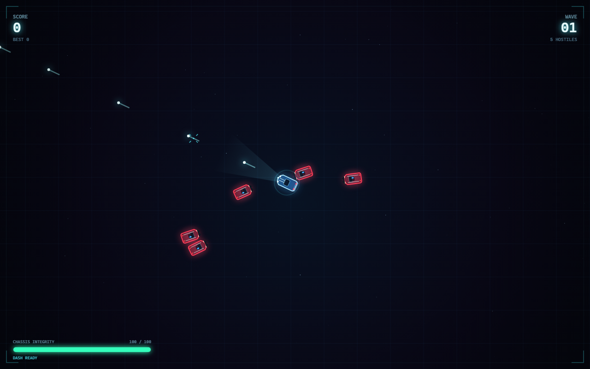

# Retro Chase

A fast, single-file neon arcade racer. You are the **blue** retro car; the **red** police cars want you gone. Survive the pursuit, stack your multiplier, and outrun the Sentinel cruiser that shows up every fifth wave.

No build step, no dependencies, no external assets — one HTML file and a canvas.

**Created by Ahnaf Obaid.**



## Play

Open `index.html` in any modern browser, or serve the folder locally:

```bash
# any one of these
npx serve .
python -m http.server 8000
```

Then visit <http://localhost:8000>.

## Controls

| Input | Action |
| --- | --- |
| `WASD` / Arrow keys | Drive |
| Mouse | Aim, hold to fire |
| `Space` | Boost / dash |
| `P` / `Esc` | Pause |
| `M` | Mute |
| Touch | Virtual sticks + boost button |

## Features

- Blue hero car vs. red police variants: chaser, spitter, brute van, and the Sentinel boss truck
- Wave-based difficulty with a boss every fifth wave
- Score multiplier, power-ups, and a persistent local high score
- Canvas 2D rendering with synthesized WebAudio sound effects
- Keyboard, mouse, and touch controls, all in one file
- Fully offline — no network requests after load

## High score

The best score is stored in `localStorage` under `retrochase.best`. Older builds used `neondrift.best`; that value is migrated automatically on first run.

## Publish with GitHub Pages

1. Create a new **public** repository on GitHub (no README, no `.gitignore`).
2. From this folder:

   ```bash
   git init -b main
   git add .
   git commit -m "Retro Chase"
   git remote add origin https://github.com/<your-username>/<repo-name>.git
   git push -u origin main
   ```

3. In the repository: **Settings → Pages → Build and deployment**
   - Source: **Deploy from a branch**
   - Branch: **main**, folder **/ (root)**
   - Save.
4. The game goes live at `https://<your-username>.github.io/<repo-name>/` within a minute or two.

`index.html` is the entry point and `.nojekyll` is included so GitHub Pages serves the files as-is.

## Created by

Ahnaf Obaid — built for fun, free to play and enjoy.

No license has been chosen. If you reuse the code, a credit is appreciated but not required.
